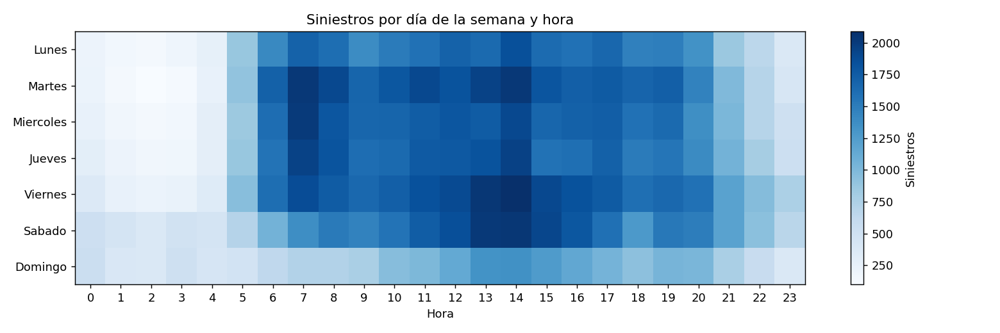

Siniestros viales en Bogotá con Apache Spark y Kafka
Tarea 3 – Procesamiento de datos con Apache Spark · Curso Big Data · Grupo 202016908_133 · UNAD
Problema
¿Cuándo, dónde y de qué tipo ocurren los siniestros viales en Bogotá, y qué localidades y
horarios concentran los más graves? Responderlo ayuda a orientar controles de tránsito y
campañas de prevención.
Conjunto de datos
Nombre: Histórico Siniestros Bogotá D.C.
Fuente: Secretaría Distrital de Movilidad – Datos Abiertos Bogotá
Tamaño: 199.146 registros, 16 columnas, CSV de 37 MB (2015 en adelante)
Columnas usadas: `CODIGO_ACCIDENTE`, `FECHA_HORA_ACC`, `GRAVEDAD`, `CLASE_ACC`, `LOCALIDAD`, `LATITUD`, `LONGITUD`
Licencia: Creative Commons Attribution 4.0
Estructura del repositorio
```
├── siniestros_batch.py            # Procesamiento batch (Spark DataFrames + RDDs)
├── kafka_producer_siniestros.py   # Productor: simula siniestros en tiempo real
├── spark_streaming_siniestros.py  # Consumidor: Spark Structured Streaming
├── resultados/
│   ├── graficas/                  # 7 gráficas PNG del análisis batch
│   └── csv/                       # Tablas resumen generadas por Spark
└── README.md
```
Entorno
Componente	Versión
Ubuntu (máquina virtual VirtualBox)	22.04.5 LTS
Java	OpenJDK 11
Apache Spark / PySpark	3.5.3
Apache Kafka	3.9.2 (Scala 2.12) con ZooKeeper
Python	3.10 + `kafka-python`, `pandas`, `matplotlib`
```bash
pip install kafka-python pandas matplotlib
```
1. Procesamiento batch
```bash
wget -O historico_siniestros_bogota.csv "https://datosabiertos.bogota.gov.co/dataset/8624f916-1db2-4c17-b669-19a19b35d1ca/resource/f5862aaa-4e1c-463e-94d5-f04db8164360/download/historico_siniestros_bogota_d.c_-.csv"

spark-submit siniestros_batch.py file:///home/vboxuser/siniestros/historico_siniestros_bogota.csv resultados
```
El script:
Carga el CSV y muestra el esquema y los valores nulos por columna.
Limpia los datos: elimina duplicados, normaliza textos (mayúsculas, sin tildes), descarta registros sin fecha, gravedad o localidad y anula coordenadas fuera de Bogotá.
Transforma los datos: crea año, mes, día de la semana, hora, franja horaria e indicadores `ES_FATAL` y `CON_VICTIMAS`.
Analiza (EDA) con DataFrames: siniestros por año, gravedad, clase, localidad, hora y día, letalidad por franja y una matriz día × hora.
Ejemplifica RDDs: `filter`, `map`, `flatMap`, `reduceByKey`, `count`, `takeOrdered`, `reduce`.
Visualiza los resultados en 7 gráficas guardadas en `resultados/graficas/`.
Resultados principales
Se procesaron 199.100 siniestros válidos (99,98% del total).
El choque representa cerca del 86% de los casos (170.760), seguido del atropello (20.136).
Hubo 3.238 siniestros con muertos. Kennedy concentra la mayor cantidad (460), seguida de Engativá (293), Suba (261), Ciudad Bolívar (246) y Fontibón (236).
La noche es casi el doble de letal: el 2,1% de los siniestros nocturnos (18–23 h) tienen muertos, frente al 1,1% en la tarde.
Entre semana el pico de siniestros está en la hora punta de la mañana (6–8 a. m.). Los fines de semana hay entre 2 y 3 veces más siniestros en la madrugada (0–4 a. m.) que los días hábiles.

2. Procesamiento en tiempo real (Kafka + Spark Streaming)
Iniciar ZooKeeper y Kafka y crear el topic
```bash
sudo /opt/Kafka/bin/zookeeper-server-start.sh -daemon /opt/Kafka/config/zookeeper.properties
sudo /opt/Kafka/bin/kafka-server-start.sh -daemon /opt/Kafka/config/server.properties
/opt/Kafka/bin/kafka-topics.sh --create --bootstrap-server localhost:9092 \
  --replication-factor 1 --partitions 1 --topic siniestros_viales
```
Terminal 1: productor
```bash
python3 kafka_producer_siniestros.py
```
El productor genera un siniestro simulado cada 0,3 a 1,5 segundos, con localidad, clase,
gravedad, coordenadas y marca de tiempo. Las probabilidades están ponderadas según el análisis
batch, y cada siniestro se envía como JSON al topic `siniestros_viales`.
Terminal 2: consumidor
```bash
spark-submit --packages org.apache.spark:spark-sql-kafka-0-10_2.12:3.5.3 spark_streaming_siniestros.py
```
Cada 10 segundos el consumidor calcula:
Siniestros por minuto según gravedad, con ventanas de 1 minuto.
Un panel por localidad (total, con víctimas, fatales y %), con una gráfica de barras en consola y otra guardada en `panel_streaming_localidades.png`.
Alertas con una ventana deslizante de 2 minutos que se mueve cada 30 segundos: localidades con 8 o más siniestros con víctimas.
Mientras corre, la interfaz web de Spark está disponible en `http://localhost:4040` (Jobs, Stages, Environment, Executors).
Autor
José Bastián Sánchez Yara – Grupo 202016908_133
